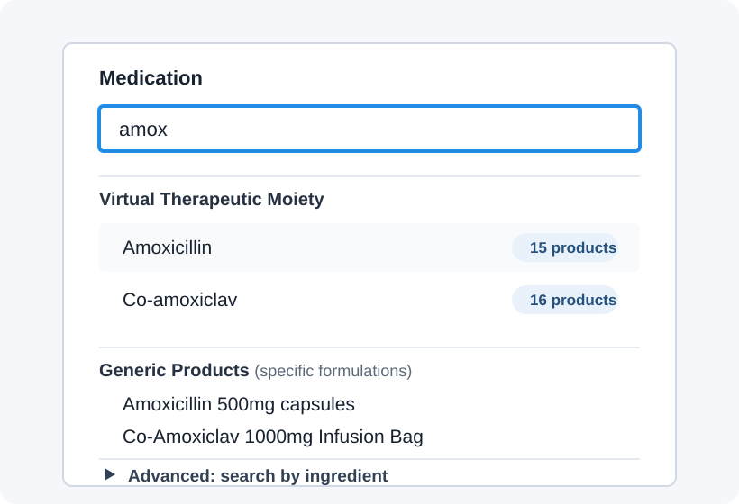

# [DRAFT] 2026-06-08 Defining Code Lists via DM+D Ingredient

* 1 [Change Details](#change-details)
* 2 [Background](#background)
* 3 [Intended Use](#intended-use)
* 4 [Justification](#justification)
* 5 [Pivotal Wireframe and Search Rationale](#pivotal-wireframe-and-search-rationale)
* 6 [Requirements](#requirements)
* 7 [Data Migration & Interoperability Considerations](#data-migration--interoperability-considerations)
* 8 [Manual Acceptance Testing](#manual-acceptance-testing)
* 9 [Future Direction](#future-direction)
* 10 [Hazard Assessment](#hazard-assessment)
* 11 [Documentation Updates](#documentation-updates)
  * 11.1 [Hazard Log](#hazard-log)
  * 11.2 [Product Documentation](#product-documentation)
  * 11.3 [Help Centre Articles](#help-centre-articles)
* 12 [Change Approval](#change-approval)

---

## Change Details

|  |  |
| :-- | :-- |
| Type of Change | Regular |
| Owner |  |

---

## Background

Code lists for medication-related clinical content (e.g. monitoring searches for NSAIDs, DMARDs, anticoagulants) need to cover all prescribable products containing a given drug substance. The NHS Dictionary of Medicines and Devices (dm+d) is the authoritative UK source for this: it organises products into a hierarchy of Virtual Therapeutic Moieties (VTM), Virtual Medicinal Products (VMP), Virtual Medicinal Product Packs (VMPP), Actual Medicinal Products (AMP), and Actual Medicinal Product Packs (AMPP), linked to ingredient substance SNOMED CT concept IDs.

Currently, the only way to express a medication code list in Medicus is via SNOMED CT ECL (e.g. descendants of a VTM) or a BNF chapter. Neither approach reliably captures all prescribable dm+d products for a given substance:

- **ECL on VTM** does not traverse the dm+d ingredient link — it follows the SNOMED is-a hierarchy, which does not include AMP/AMPP product codes.
- **BNF chapter** is a broad classification that does not map 1:1 to substances and includes products from adjacent classes.

The dm+d `ingredient` → `vmp_ingredient` → `vmp` → `vmpp` / `amp` → `ampp` relational model provides a precise, maintainable way to derive every prescribable product for a given set of ingredient substance concept IDs, including combination products that contain the ingredient alongside others.

This approach is consistent with how EMIS Health models constituent-based medication searches via `SCT_CONST` with `includeChildren=true` in its search export XML — where the intent is "find all products containing this ingredient". A SNOMED ECL expression on a VTM (`<< vtmId`) is insufficient because it only covers single-ingredient products under that VTM; combination products (e.g. Simvastatin+Ezetimibe, Fenofibrate+Simvastatin) sit under separate VTMs and would not be captured. Similarly, SNOMED "product containing" hierarchy searches require enumerating multiple hierarchy roots and are not maintainable as the substance list grows. For a full analysis of these scenarios see [Background to Enterprise Search XML](https://medicus-health.atlassian.net/wiki/x/AYDrhAE).

---

## Intended Use

Clinical content authors (internal Medicus developers and third-party content providers) will use this to define medication code lists for drug classes where the list of prescribable products must be complete and automatically maintained as dm+d is updated weekly.

Example use cases:

- NSAIDs monitoring — find all prescriptions for any of a defined set of NSAID substance concepts
- DMARD monitoring — find all methotrexate, leflunomide, sulfasalazine products
- High-risk drug reviews — any product containing a target ingredient, regardless of brand, formulation, or pack size

For XML-authored code lists, the workflow is the same as today: the author writes an XML code list definition, submits it, and the Code List Publishing Service evaluates it and produces a flat list of codes. For the Custom Report Builder medication search, this change alters the ordering and behaviour of results within the existing medication search dropdown; it does not introduce a separate medication search box and does not change medication search in other Medicus workflows.

---

## Justification

Medication-related searches are among the highest-volume and highest-risk use cases in Medicus. An incomplete medication code list (e.g. missing an AMP because it was added in a recent dm+d release, or missing a parallel import product) is a patient safety risk — the search will fail to flag a patient who is on the drug.

Maintaining these lists manually is unsustainable: dm+d is updated weekly and the NSAID class alone has over 4,500 active products across VMP/VMPP/AMP/AMPP levels. An ingredient-driven definition that re-evaluates against the current dm+d on each release guarantees completeness without manual curation.

---

## Pivotal Wireframe and Search Rationale

The pivotal user-facing decision is that Custom Report Builder medication search must be **VTM-first**. A raw Ingredient-first result list is unsafe for the common clinical search pattern: selecting the base `Amoxicillin` ingredient can return zero products, while prefix matching can surface unrelated substances such as `Amoxapine`. That makes Ingredient a specialist search mode, not the primary path for a GP or content author trying to define a medication cohort.



For the search term `amox`, the expected result order is:

1. **Virtual Therapeutic Moiety** — primary results, shown first and visually dominant.
2. **Generic Products** — specific formulations, shown below VTM results and treated as a secondary/drill-down path.
3. **Advanced: search by ingredient** — collapsed by default and reserved for specialist use.

The VTM result is the concept that matches clinical intent. `Amoxicillin` as a VTM returns the 15 direct amoxicillin VMPs, including products whose underlying ingredient rows use salt forms such as amoxicillin sodium or amoxicillin trihydrate. `Co-amoxiclav` appearing as a separate VTM is correct because it lets the author explicitly decide whether to include the combination.

Design requirements from this wireframe:

- Ingredient results must not appear above VTM results. They should be hidden behind `Advanced: search by ingredient` or clearly labelled as chemical substances for specialist use.
- Duplicate-looking entries such as `Amoxicillin` under Ingredient and `Amoxicillin` under VTM must not be shown as equivalent choices. If an ingredient must be shown, label it as `chemical substance - advanced use` and show that it does not directly represent the product set.
- VTM rows must show product counts, e.g. `Amoxicillin - 15 products` and `Co-amoxiclav - 16 products`, so users can see the scope of what they are selecting.
- A selected VTM should offer an explicit `include combination products` option. For `Amoxicillin`, this would include the 16 co-amoxiclav VMPs via the ingredient pivot; for drugs such as metformin it prevents combination products from being missed without forcing the user to manually select many related VTMs.
- Generic product rows must not compete with VTM rows. They may remain visible as lower-priority specific formulation matches, or become a drill-down after a VTM is selected if result volume becomes difficult to scan.

This is why the implementation needs both behaviours: VTM-first search for the normal clinical path, and a controlled ingredient pivot for the explicit "include combinations" case.

---

## Requirements

### New Expression Syntax

A new expression type is added to the code list definition syntax:

```
DMD INGREDIENT {isid} |{FSN}|
```

Where `{isid}` is the SNOMED CT substance concept ID for the ingredient (as found in the dm+d `ingredient.isid` column, e.g. `387584000` for Simvastatin). The `|{FSN}|` part is optional and for human readability only, consistent with the existing SNOMED CT expression syntax. The FSN **should** include the SNOMED semantic tag `(substance)` to make it unambiguous that a substance concept ID has been used rather than a VTM concept ID.

> **Note:** The `{isid}` value is the **SNOMED substance concept ID**, not the dm+d VTM concept ID. These are different: `387584000 |Simvastatin (substance)|` is the substance, while `777537002 |Simvastatin|` is the VTM. A single substance may appear as an ingredient across multiple VTMs (single-ingredient and combination), and the ingredient join captures all of them in one expression. Using the FSN with `(substance)` tag helps authors verify they have used the correct identifier.

Multiple ingredients may be specified as separate inclusion rules within a single `<rules>` block:

```xml
<codelistDefinition>
  <rules>
    <inclusion>DMD INGREDIENT 387207008 |Ibuprofen (substance)|</inclusion>
    <inclusion>DMD INGREDIENT 372588000 |Naproxen (substance)|</inclusion>
    <inclusion>DMD INGREDIENT 42692007 |Naproxen sodium (substance)|</inclusion>
  </rules>
  <!-- Exclude combination products with opioids -->
  <rules>
    <exclusion>DMD INGREDIENT 261000 |Codeine phosphate (substance)|</exclusion>
  </rules>
</codelistDefinition>
```

### Full Example — Methotrexate

The following is a complete code list definition for methotrexate. Two substance concepts are required because some dm+d VMPs are linked to the salt form (`Methotrexate sodium`) rather than the base substance. There are no combination products for methotrexate in dm+d, so no exclusion rules are needed.

```xml
<codeList>
    <name>Methotrexate Products</name>
    <responsibleOrganisation>Medicus Health Ltd</responsibleOrganisation>
    <externalIdentifier>medicus-health/methotrexate-products</externalIdentifier>
    <codeSystem>NHS Dictionary of Medicines and Devices</codeSystem>
    <intendedUse>
        Used to identify prescriptions of methotrexate in any form or brand
        for use in DMARD monitoring searches and high-risk medicine reviews.
    </intendedUse>
    <methodology>
        All VMPs, VMPPs, AMPs and AMPPs from NHS dm+d derived by ingredient
        search on the two methotrexate substance concepts: Methotrexate (387381009)
        and Methotrexate sodium (412247000). Both substances are included because
        some dm+d VMPs are linked to the salt form rather than the base substance.
        Includes oral tablets, oral solutions, subcutaneous pre-filled syringes,
        intramuscular injections, and high-dose IV preparations. Includes both
        active and inactive (invalid) products to support lookback over historical
        prescriptions.
    </methodology>
    <authors>
        <author>Medicus Health Ltd</author>
    </authors>
    <codelistDefinition>
        <!-- Methotrexate base substance - covers oral and injectable products -->
        <rules>
            <inclusion>DMD INGREDIENT 387381009 |Methotrexate (substance)|</inclusion>
        </rules>
        <!-- Methotrexate sodium - some VMPs are linked to the salt form -->
        <rules>
            <inclusion>DMD INGREDIENT 412247000 |Methotrexate sodium (substance)|</inclusion>
        </rules>
    </codelistDefinition>
</codeList>
```

**Expected output — current dm+d release (June 2026):**

| Level | Active (invalid=0) | Inactive (invalid=1) | Total |
| :-- | --: | --: | --: |
| VMP | 110 | 0 | 110 |
| VMPP | 129 | 0 | 129 |
| AMP | 220 | 0 | 220 |
| AMPP | 264 | 0 | 264 |
| **Total** | **723** | **0** | **723** |

All 723 current products are active. No inactive (superseded) methotrexate products exist in the current dm+d release. The count will grow over time as new branded AMPs and parallel import AMPPs are licensed.

This illustrates two important points:
- **Multiple substance concepts may be needed for a single drug** — always check both the base substance and any commonly used salt forms in the dm+d `ingredient` table before finalising the definition
- **No exclusions are required when there are no combination products** — the definition is inclusion-only; the absence of exclusion rules is intentional and should be documented in the `<methodology>`

---

### Worked Example — Paracetamol with Codeine Phosphate Exclusion

The following example shows the effect of including all paracetamol products, then excluding products that also contain Codeine phosphate. In the June 2026 dm+d import, the relevant ingredient substance IDs are:

| Ingredient | dm+d `ingredient.isid` | Notes |
| :-- | :-- | :-- |
| Paracetamol | `387517004` | Base substance used by paracetamol VMP ingredients |
| Codeine phosphate | `261000` | Salt form used by co-codamol and branded codeine/paracetamol combinations |

> **Important:** `373492002` is `Fentanyl` in the dm+d `ingredient` table and must not be used for Codeine phosphate.

```xml
<codeList>
    <name>Paracetamol Products excluding Codeine Phosphate Combinations</name>
    <responsibleOrganisation>Medicus Health Ltd</responsibleOrganisation>
    <externalIdentifier>medicus-health/paracetamol-products-excluding-codeine-phosphate</externalIdentifier>
    <codeSystem>NHS Dictionary of Medicines and Devices</codeSystem>
    <intendedUse>
        Used to identify prescriptions for products containing paracetamol,
        excluding co-codamol and other paracetamol combinations that contain
        Codeine phosphate.
    </intendedUse>
    <methodology>
        All VMPs, VMPPs, AMPs and AMPPs from NHS dm+d derived by ingredient
        search on Paracetamol (387517004). Products are then removed where
        their parent VMP contains Codeine phosphate (261000). Includes both
        active and inactive (invalid) products to support lookback over
        historical prescriptions.
    </methodology>
    <authors>
        <author>Medicus Health Ltd</author>
    </authors>
    <codelistDefinition>
        <rules>
            <inclusion>DMD INGREDIENT 387517004 |Paracetamol (substance)|</inclusion>
        </rules>
        <rules>
            <exclusion>DMD INGREDIENT 261000 |Codeine phosphate (substance)|</exclusion>
        </rules>
    </codelistDefinition>
</codeList>
```

**Expected output — local dm+d release `nhsbsa_dmd_6.0.0_20260601000001`:**

| Result set | Level | Active (invalid=0) | Inactive (invalid=1) | Total |
| :-- | :-- | --: | --: | --: |
| Included before exclusion | VMP | 149 | 12 | 161 |
| Included before exclusion | VMPP | 360 | 28 | 388 |
| Included before exclusion | AMP | 844 | 0 | 844 |
| Included before exclusion | AMPP | 1,394 | 45 | 1,439 |
| **Included before exclusion** | **Total** | **2,747** | **85** | **2,832** |
| Removed by Codeine phosphate exclusion | VMP | 29 | 5 | 34 |
| Removed by Codeine phosphate exclusion | VMPP | 89 | 14 | 103 |
| Removed by Codeine phosphate exclusion | AMP | 239 | 0 | 239 |
| Removed by Codeine phosphate exclusion | AMPP | 367 | 22 | 389 |
| **Removed by Codeine phosphate exclusion** | **Total** | **724** | **41** | **765** |
| Final after exclusion | VMP | 120 | 7 | 127 |
| Final after exclusion | VMPP | 271 | 14 | 285 |
| Final after exclusion | AMP | 605 | 0 | 605 |
| Final after exclusion | AMPP | 1,027 | 23 | 1,050 |
| **Final after exclusion** | **Total** | **2,023** | **44** | **2,067** |

The exclusion removes the overlapping VMPs that contain both Paracetamol and Codeine phosphate, and then removes their descendant VMPP, AMP and AMPP codes. Examples removed include co-codamol VMPs such as `42010211000001106 |Co-codamol 8mg/500mg tablets|`, `42009811000001101 |Co-codamol 30mg/500mg tablets|`, and branded/generic multi-ingredient products such as Solpadeine Plus and Syndol variants.

This example also shows the clinical boundary of the exclusion. It removes Codeine phosphate combinations only. Other paracetamol opioid combinations remain in the final list unless their ingredients are also excluded, including:

- `322538006 |Dihydrocodeine tartrate (substance)|` — co-dydramol products
- `56297001 |Dextropropoxyphene hydrochloride (substance)|` — co-proxamol products
- `108505002 |Tramadol hydrochloride (substance)|` — tramadol/paracetamol products

If the intended code list is "paracetamol excluding all opioid combinations", the exclusion rules must enumerate each opioid ingredient represented in dm+d, not only Codeine phosphate.

---

### dm+d Levels Returned

A `DMD INGREDIENT` inclusion rule resolves to codes at the following dm+d levels:

| Level | Included by default | Notes |
| :-- | :-- | :-- |
| VTM | No | VTMs are SNOMED concepts — use ECL `<<` on the VTM concept ID if VTMs are needed |
| VMP | Yes | All VMPs linked to the ingredient via `vmp_ingredient` |
| VMPP | Yes | All VMPPs whose parent VMP is in the resolved VMP set |
| AMP | Yes | All AMPs whose parent VMP is in the resolved VMP set |
| AMPP | Yes | All AMPPs whose parent AMP is in the resolved AMP set |

The resolved set is the **union** of all products containing **any** of the listed ingredients (i.e. a VMP that contains both ibuprofen and codeine will be included by an ibuprofen inclusion rule, and can then be removed by a codeine exclusion rule).

### Active vs Inactive Codes

The existing Active vs Inactive Codes behaviour applies: by default the Code List Publishing Service includes **both active and inactive** dm+d product codes so that the code list captures historical prescriptions. The `invalid` flag in dm+d is used to differentiate active from inactive codes and this is reflected in the code list version metadata, consistent with how inactive SNOMED CT codes are handled today.

### Code System

The code system is mandatory and determines which terminology release the code list definition should be evaluated against. `DMD INGREDIENT` expressions require `<codeSystem>` to be set to `NHS Dictionary of Medicines and Devices`.

```xml
<codeSystem>NHS Dictionary of Medicines and Devices</codeSystem>
```

Allowed values:

- `SNOMED CT UK Monolith Edition`
- `NHS Dictionary of Medicines and Devices`

The Code List Publishing Service must resolve `DMD INGREDIENT` expressions against the **dm+d database** (not the SNOMED CT hierarchy tables), because the ingredient–product relationship is modelled in the dm+d relational schema and is not represented in the SNOMED CT is-a hierarchy.

The output codes are dm+d product codes issued under the `NHS Dictionary of Medicines and Devices` code system. A code list with `codeSystem` set to `NHS Dictionary of Medicines and Devices` may not mix `DMD INGREDIENT` rules with SNOMED CT ECL or BNF Chapter rules.

### Versioning and Re-evaluation Cadence

dm+d is updated **weekly on a Monday**, whereas the SNOMED CT UK Drug Extension is released **every 4 weeks on a Wednesday**. NHS England confirmed these release cycles in its dm+d and SNOMED CT UK Drug Extension release-cycle survey summary: https://digital.nhs.uk/services/terminology-and-classifications/uk-medicines-terminology-futures/changes-to-digital-terminologies/survey-dm-d-and-snomed-ct-uk-drug-extension-release-cycles. A new dm+d release may add or retire products without a corresponding SNOMED CT version bump.

To handle this, a new trigger is introduced alongside the existing SNOMED CT version check:

- The system tracks the current dm+d release version
- When a new dm+d release is imported, all published code lists that contain at least one `DMD INGREDIENT` rule are re-evaluated and a new minor version is created, in the same way that a SNOMED CT import triggers re-evaluation today

### Validation

The Code List Publishing Service must validate that each `{isid}` in a `DMD INGREDIENT` expression exists in the dm+d `ingredient` table at the time of evaluation. If it does not, the evaluation must fail with a descriptive error message identifying the unknown `{isid}`.

### Updated Syntax Reference Table

The following row is added to the expression syntax table in the existing documentation:

| Syntax | Format | Example |
| :-- | :-- | :-- |
| **DM+D Expressions** | | |
| All VMPs, VMPPs, AMPs and AMPPs containing the ingredient | `DMD INGREDIENT {isid}`<br>`DMD INGREDIENT {isid} \|{FSN}\|` | `DMD INGREDIENT 387207008`<br>`DMD INGREDIENT 387207008 \|Ibuprofen (substance)\|` |

### Automated Testing Requirements

- Prove that a `DMD INGREDIENT` inclusion rule returns VMP, VMPP, AMP and AMPP codes for a known substance, and does **not** return VTM codes
- Prove that a combination product VMP (containing two ingredients) is included when either of its ingredient substance concept IDs is specified in an inclusion rule
- Prove that a combination product VMP is excluded when an exclusion rule is specified for one of its co-ingredients, even if the other ingredient has an inclusion rule
- Prove that specifying an `{isid}` that does not exist in the dm+d `ingredient` table causes evaluation to fail with a descriptive validation error
- Prove that a `DMD INGREDIENT` rule resolves correctly when `<codeSystem>` is `NHS Dictionary of Medicines and Devices`
- Prove that a `DMD INGREDIENT` rule fails validation when `<codeSystem>` is set to `SNOMED CT UK Monolith Edition`
- Prove that all published code lists containing at least one `DMD INGREDIENT` rule are re-evaluated when a new dm+d release is imported
- Prove that inactive (`invalid=1`) dm+d products are included in the resolved code list by default, consistent with existing behaviour for inactive SNOMED CT codes

---

## Data Migration & Interoperability Considerations

No data migration is required. Existing code lists are unaffected. Code lists that use `DMD INGREDIENT` rules produce dm+d product codes under the `NHS Dictionary of Medicines and Devices` code system. The consuming tenant synchronisation model already stores codes as strings without assuming a specific code system, so no changes to the synchronisation model are required.

---

## Manual Acceptance Testing

- Create a code list using a single `DMD INGREDIENT` rule for a well-known substance (e.g. `387584000 |Simvastatin (substance)|`) and verify that the resulting flat code list contains the expected VMPs, VMPPs, AMPs and AMPPs — including combination products (e.g. Simvastatin+Ezetimibe, Fenofibrate+Simvastatin) — but no VTMs
- Create a code list using multiple `DMD INGREDIENT` inclusion rules and verify that the result is the union of all matched products
- Create a code list using a `DMD INGREDIENT` inclusion rule followed by a `DMD INGREDIENT` exclusion rule for a co-ingredient, and verify that combination products containing the excluded co-ingredient are removed
- Import a mock new dm+d release and verify that code lists containing `DMD INGREDIENT` rules are automatically re-evaluated and a new minor version is created
- Verify that specifying an invalid `{isid}` returns a user-facing validation error
- A video or screenshots posted to the Jira ticket and sign off from the change owner
- Code Review

---

## Future Direction

- **VTM inclusion option**: An optional modifier (e.g. `DMD INGREDIENT {isid} INCLUDE VTM`) to also return the VTM for the substance, for systems that code at VTM level
- **Level filtering**: An optional modifier (e.g. `DMD INGREDIENT {isid} LEVELS VMP,AMP`) to restrict which dm+d levels are returned, for use cases where AMPP-level granularity is not needed
- **Direct product-level expressions**: A companion `DMD VMP {vpid}` / `DMD AMP {apid}` syntax for cherry-picking specific products by dm+d identifier without going via ingredient
- **Multiple ingredients per expression**: A shorthand `DMD INGREDIENT {isid1}, {isid2}, {isid3}` to express a substance group in a single line rather than multiple inclusion rules

---

## Hazard Assessment

A `DMD INGREDIENT` rule that resolves to an incomplete set of products (e.g. due to a missing ingredient link in dm+d, or a bug in the evaluation logic) could cause a monitoring search to miss patients on the drug. This is a patient safety risk and should be assessed against the existing Hazard Log entry for incomplete medication code lists.

Mitigations:

- Validation at evaluation time that all `{isid}` values exist in the current dm+d release
- Automated tests that assert known product counts for stable substances (regression guard against evaluation regressions after dm+d updates)
- The weekly re-evaluation trigger ensures that newly added products are captured promptly

---

## Documentation Updates

### Hazard Log

Review existing hazard entries for incomplete medication code lists. Add or update a hazard entry to cover the risk of `DMD INGREDIENT` resolution failing silently on dm+d update.

### Product Documentation

Update **Defining & Managing Code Lists** as follows:

1. **Section 4 — Code List Publishing Service**: add a note that the service evaluates `DMD INGREDIENT` expressions against the dm+d database in addition to SNOMED CT
- **Section 5.5 — Code System**: add `NHS Dictionary of Medicines and Devices` as a new allowed `codeSystem` value, with a note that it is required for `DMD INGREDIENT` expressions
3. **Section 5.9 — Definition**: add the `DMD INGREDIENT` syntax row to the expression syntax reference table and add an example code list definition for a multi-substance drug class
4. **Section 5.10 — Active vs Inactive Codes**: note that inactive dm+d products (`invalid=1`) are treated equivalently to inactive SNOMED CT codes
5. **Section 9 — Creating a New Minor Version**: extend to document that dm+d weekly imports also trigger re-evaluation of code lists containing `DMD INGREDIENT` rules

### Help Centre Articles

No help centre articles are impacted (code list authoring is not exposed to end users).

---

## Change Approval

| Review | Date Reviewed | Reviewed By | Comments |
| :-- | :-- | :-- | :-- |
| Product Design | | | |
| Clinical Safety | | | |
| Information Governance | | | |
| Technical Implementation | | | |
| Information Security | | | |
| Senior Responsible Officer (SRO) Sign Off | | | |
