# Context


# VTM-First Medication Search - Algorithm Design Notes

**Date:** 2026-06-23  
**Context:** Supporting the design of the Custom Report Builder medication search feature (2026-06-18 change proposal)

---

## Background Questions

### Q1: How do clinicians think about ingredients?

They don't think about salts at all. A clinician knows "methotrexate" - they don't know or care that some injectables are linked to "methotrexate sodium" in the underlying data. They would be confused and frustrated if a search for "methotrexate" missed the injections. The same applies to amoxicillin, warfarin, simvastatin - the salt distinction is pharmaceutical chemistry, not clinical knowledge.

Iron is a slightly different case. Clinicians do distinguish oral iron from IV iron, but that is a **route** distinction - oral tablets vs IV infusion - not a salt chemistry distinction. The reason Ferrous sulfate, Ferrous fumarate and Ferric carboxymaltose have separate VTMs in dm+d is because they are considered clinically non-interchangeable (you would not freely switch a dialysis patient from iron sucrose to ferrous sulfate). That separation is intentional and clinically valid - "iron" as a single search concept has no clean algorithmic answer.

---

### Q2: How do competitor EPRs handle this? - EMIS

EMIS Web Code Selector has three tabs: **Groups**, **Ingredients**, **Approved names**.

- **Groups** (the default): EMIS-proprietary, manually curated by their Informatics Pharmacists in the MKB. Updated monthly. This is how they solve the iron problem - a pharmacist decided "Oral Iron Therapy" contains Ferrous sulfate, Ferrous fumarate, Ferrous gluconate etc. Not algorithmic. Requires ongoing maintenance resource.
- **Ingredients**: searches the dm+d active ingredient table directly. This tab has the salt form problem - searching "amoxicillin" returns separate entries for each salt form, and the base form has zero products behind it. This is almost certainly why Groups is the default tab.
- **Approved names**: searches the rINN/BAN name from the preparation description - closer to VTM-level but not exactly equivalent.

**Observed in EMIS Web (June 2026) - Groups tab, search "iron":**

Searching "iron" in the Groups tab returns three results: _Drugs Used In Iron Deficiency Anaemia_, _Oral Iron Therapy_, and _Parenteral Iron Therapy_. The right-hand panel shows a hierarchy:

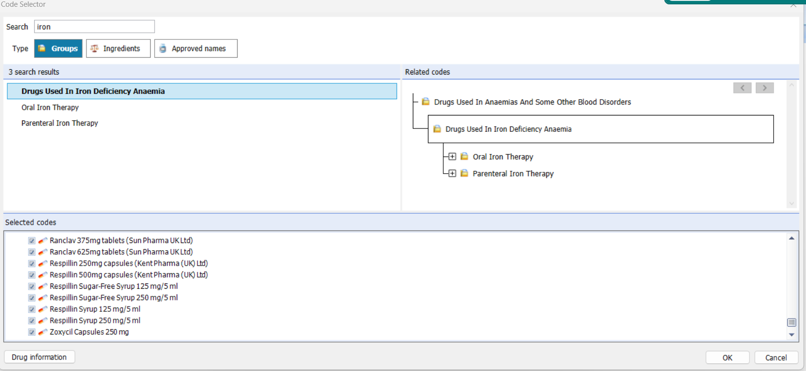

```
Drugs Used In Anaemias And Some Other Blood Disorders
  └── Drugs Used In Iron Deficiency Anaemia
        ├── Oral Iron Therapy
        └── Parenteral Iron Therapy
```

Selecting any of these groups populates the selected codes panel with individual AMPPs - the flat product list EMIS uses in that selector. The groups are EMIS-proprietary: they are not derived from BNF chapter codes and are not part of dm+d. They are curated and maintained by EMIS's Informatics Pharmacists in the MKB.

**Observed in EMIS Web (June 2026) - Ingredients tab, search "amoxicillin":**

Switching to the Ingredients tab and searching "amoxicillin" returns two entries: _Amoxicillin_ and _Amoxicillin Trihydrate_. Notably, Amoxicillin sodium does not appear as a separate entry - EMIS's MKB curation appears to have merged or suppressed it. The right-hand panel shows an "EMIS Drug Terms" hierarchy (All Groups → EMIS Approved Names / EMIS Ingredients) rather than a product tree, indicating no products are yet selected. This confirms that selecting an ingredient name here is the first step in a manual multi-select flow, not an automatic expansion.

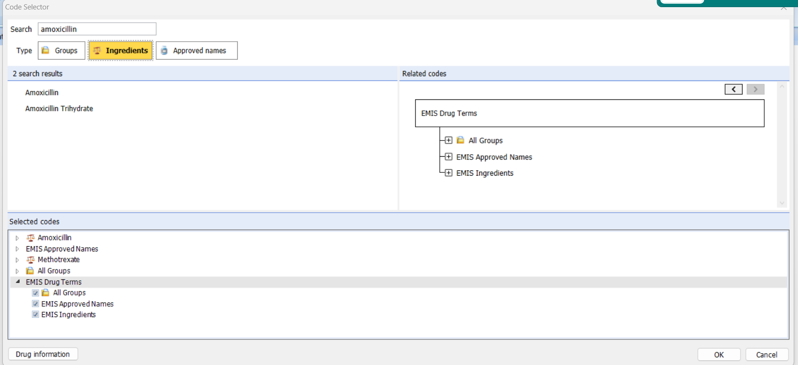

This directly validates the salt form concern: a clinician searching "amoxicillin" in the Ingredients tab would see two separate entries and would need to know to select both. If they selected only "Amoxicillin" (the base), they would miss all oral amoxicillin capsules and suspensions (which are trihydrate). The Groups tab avoids this by pre-grouping the products under a curated heading.

EMIS solves the salt form problem well only via the Groups tab, which requires ongoing pharmacist maintenance. Their Ingredients tab exposes the same salt form problem that a raw ingredient ISID search would introduce.


---

### On the three design approaches

**Option 1 - Require the user to manually select all applicable ingredients**

No. This is what we do for technical content authors writing XML codelists - it is not acceptable for clinicians. A GP cannot be expected to know that "amoxicillin" is linked to two distinct ingredient ISIDs in dm+d, let alone know which ones.

**Option 2 - When user selects a drug, automatically include all associated salts and combination products**

Yes - but the key insight is that **you do not need an algorithm for salt handling**. The dm+d VTM already groups them. If you search the VTM table (not the ingredient table) and traverse VTM → VMP directly, all salt forms come back automatically:

| VTM searched | Direct VMPs | What is included automatically |
| :-- | --: | :-- |
| Methotrexate | 110 | All methotrexate sodium injectables |
| Amoxicillin | 15 | Both amoxicillin sodium and amoxicillin trihydrate |
| Warfarin | 26 | All warfarin sodium products - complete result |

The search primitive should be **drug name → VTM → VMPs → AMPs**, not ingredient name → ingredient ISID → VMPs. The VTM is the concept that matches how clinicians think, the VMP set is the clinical scope, and the AMP set is the executable prescription-matching scope.

This distinction matters because the current wireframes mostly preview associated VMPs. That is useful, but it is not enough for a report runner. If prescribing records are stored against AMPs, the saved criterion must expand every resolved VMP to its child AMPs before matching prescriptions. VMPP/AMPP pack records may exist as separate adjunct data, but they are not stored against the prescription issue in our system and must not drive patient inclusion. In other words, VMPs are the discovery and explanation layer; AMPs are the operational match layer.

The ingredient expansion layer then becomes a separate, optional question: do you also want products where this drug appears as a component of a combination? Searching "amoxicillin" and also getting co-amoxiclav (+16 VMPs), or "simvastatin" and also getting Inegy and Cholib (+6 VMPs). The answer depends on clinical intent - which makes it a good candidate for an explicit **"include combination products"** toggle.

**Option 3 - Allow salt-specific search as a specialist mode**

Valid as an advanced or power-user mode. It could be surfaced only when a user explicitly wants to narrow - for example a pharmacist checking a specific formulation. Not something a GP building a report would ever need, and should not be the default.

---

## The Algorithm

### Step-by-step walkthrough - Amoxicillin

**Step 1 - User types "amoxicillin". System searches `vtm.nm`.**

```
Result: Amoxicillin  (VTM id: 774586009)
```

**Step 2 - User selects the VTM. System fetches all VMPs directly under it.**

All 15 VMPs are returned. Salt forms resolve automatically - no additional logic needed:

| VMP name | Ingredient linked in dm+d |
| :-- | :-- |
| Amoxicillin 1g powder for solution for injection vials | Amoxicillin **sodium** |
| Amoxicillin 250mg powder for solution for injection vials | Amoxicillin **sodium** |
| Amoxicillin 500mg powder for solution for injection vials | Amoxicillin **sodium** |
| Amoxicillin 500mg/50ml infusion bags | Amoxicillin **sodium** |
| Amoxicillin 125mg/5ml oral suspension | Amoxicillin **trihydrate** |
| Amoxicillin 250mg capsules | Amoxicillin **trihydrate** |
| Amoxicillin 500mg capsules | Amoxicillin **trihydrate** |
| Amoxicillin 500mg tablets | Amoxicillin **trihydrate** |
| *(7 further oral forms)* | Amoxicillin **trihydrate** |

The clinician never sees "amoxicillin sodium" or "amoxicillin trihydrate". They typed one word and received a complete, correct product set.

**Step 3 (optional, if "include combinations" is ON) - Collect ISIDs and pivot across dm+d.**

The system collects the distinct ingredient ISIDs it found in step 2:

| ISID | Ingredient |
| :-- | :-- |
| `427483001` | Amoxicillin sodium |
| `96068000` | Amoxicillin trihydrate |

It then searches the whole of dm+d for any VMP containing either ISID as an ingredient, regardless of which VTM it belongs to:

```
                    [Amoxicillin VTM]
                          |
                     15 direct VMPs
              (sodium injections + trihydrate oral)
                          |
               discover ISIDs: 427483001, 96068000
                          |
          ┌───────────────┴───────────────┐
     15 already found              +16 via shared ISID
                                          |
                                  [Co-amoxiclav VTM]
                              Co-amoxiclav 250mg/125mg tablets
                              Co-amoxiclav 500mg/125mg tablets
                              Co-amoxiclav 875mg/125mg tablets
                              Co-amoxiclav 125mg/31mg/5ml oral suspension
                              Co-amoxiclav 250mg/62mg/5ml oral suspension
                              Co-amoxiclav 400mg/57mg/5ml oral suspension
                              Co-amoxiclav 1000mg/200mg powder for injection
                              ... (9 further IV/infusion forms)
```

**Total: 31 VMPs** (15 direct + 16 combination products)

The combination products are found not by knowing about co-amoxiclav in advance, but because the ingredient ISID acts as a bridge between two otherwise unconnected VTMs. The co-amoxiclav VMPs have two ingredient rows each - one for amoxicillin trihydrate and one for clavulanic acid. The amoxicillin trihydrate row is what the pivot matches.

---

## Algorithm Definition

```
INPUT:  vtmid   - the VTM selected by the user
        include_combinations  - boolean toggle

OUTPUT: clinical scope as VMPs, plus executable prescription scope as AMPs

1. GUARD
   If vtm.nm LIKE '% + %' OR vtm.nm LIKE 'Co-%':
     → This is a named combination VTM (e.g. "Lidocaine + Adrenaline"
       or "Co-amoxiclav")
     → Return VMPs directly linked to this VTM, then expand those VMPs to
       AMPs for prescription matching. Stop here.
     → Reason: the VTM already IS the specific combination the user chose;
       expanding via ingredients would pull in unrelated products containing
       those common component substances.

2. DIRECT TRAVERSAL
   SELECT all VMPs WHERE vmp.vtmid = vtmid
   → This automatically includes all salt/form variants (sodium, trihydrate,
     hydrochloride, etc.) because dm+d links all forms under the same VTM.
   → Salt handling is free - no additional logic required.

3. INGREDIENT PIVOT  (only if include_combinations = true)
   a. Collect DISTINCT isid values from vmp_ingredient for all VMPs found in step 2
   b. Search vmp_ingredient globally for any VMP containing those isids
   c. Exclude VMPs already found in step 2
   d. Add the new VMPs - these are combination products containing the drug

4. EXPAND DOWN THE HIERARCHY
   For each VMP found:
     a. Fetch child AMPs and retain their parent VMP ids
     b. Save both:
        - VMP set for clinical explanation and audit
        - AMP set for actual prescription matching
```

The important implementation boundary is that the ingredient pivot still runs at VMP level, because `vmp_ingredient` is the dm+d bridge that finds combination VTMs. Once the final VMP set is known, the resolver must always expand down to AMP before execution. A count of 31 VMPs for expanded amoxicillin is not the final prescription match list; it is the clinical family count that generates a larger set of actual products.

The guard in step 1 prevents over-expansion for named combination VTMs. Without it, searching "Lidocaine + Adrenaline" and then pivoting via the lidocaine ISID would return 130 VMPs across all lidocaine-containing products - dental preparations, topical anaesthetics, IV injections - none of which the user intended. The `Co-%` arm is required for British pharmacopoeial fixed-combination names such as Co-amoxiclav, Co-codamol and Co-methiamol, which do not contain the `" + "` separator but have the same over-expansion risk.

---

## Second Example - Metformin

Metformin illustrates the other direction of the problem: no salt form complexity, but dramatic combination product expansion.

**Step 2 output - one ingredient ISID only:**

| ISID | Ingredient | Direct VMPs |
| :-- | :-- | --: |
| `109083009` | Metformin hydrochloride | 23 |

No salt form issue here. All 23 VMPs under the Metformin VTM use the same ingredient.

**Step 3 output - pivot across dm+d:**

```
                    [Metformin VTM]
                          |
                     23 direct VMPs
                  (all use ISID: 109083009
                   Metformin hydrochloride)
                          |
                    pivot: search all dm+d
                    for ISID 109083009
                          |
     ┌────────┬───────────┼──────────┬────────┬────────────────────┐
     |        |           |          |        |                    |
  Sitagliptin Dapagliflozin Empagliflozin Linagliptin  ... 6 more VTMs
  +Metformin  +Metformin   +Metformin   +Metformin
  (2 VMPs)    (2 VMPs)      (4 VMPs)    (2 VMPs)
```

All 10 combination VTMs found, all 22 combination VMPs confirmed to use exactly `ISID 109083009 | Metformin hydrochloride` - the same ISID as the direct VMPs. The bridge is reliable because NHS BSA requires manufacturers to register the ingredient of every VMP, regardless of whether it is a standalone or combination product.

**Total: 45 VMPs** (23 direct + 22 combination across 10 VTMs)

| | Amoxicillin | Metformin |
| :-- | :-- | :-- |
| Ingredient ISIDs discovered | 2 (sodium + trihydrate) | 1 (hydrochloride only) |
| Salt form issue? | Yes - two distinct chemical forms | No - one form used universally |
| Combination VTMs found | 1 (Co-amoxiclav) | 10 (every modern combination diabetes drug) |
| Direct VMPs | 15 | 23 |
| Expanded VMPs | 31 (×2.1) | 45 (×2.0) |

Metformin makes the clinical stakes clearer. A patient on Xigduo (dapagliflozin + metformin) or Janumet (sitagliptin + metformin) is on metformin and should appear in any metformin-based report - a diabetes audit, an SGLT2 prescribing review, a renal safety check. Without the combination expansion, they vanish entirely. Their prescription is coded against the combination VTM, not the Metformin VTM, and a VTM-direct-only search will never find them.

---

## Clinical Use Cases

### 1. DMARD monitoring - Methotrexate

> "Which patients are on methotrexate? I need to send monitoring reminders."

- VTM-direct: **110 VMPs**. Expansion adds nothing (no combination products for methotrexate in dm+d).
- Catches oral tablets, subcutaneous pre-filled syringes AND high-dose IV preparations - all under one VTM, across both base substance and sodium salt.
- Clinician types one word, gets a complete result. Toggle: **OFF**.

---

### 2. Anticoagulant management - Warfarin

> "List patients on warfarin for an INR audit."

- VTM-direct: **26 VMPs**, expanding to **111 AMPs** for prescription issue matching. Warfarin is never combined with other drugs, so expansion adds nothing.
- Simple, clean, no toggle decision needed.

---

### 3. Statin drug interaction alert - Simvastatin

> "A safety alert says simvastatin >40mg is contraindicated with this new antibiotic. Find all affected patients."

- VTM-direct: **13 VMPs**. With expansion: **19 VMPs** (+6), expanding to **202 AMPs** for prescription issue matching.
- The 6 extra are Inegy (Simvastatin + Ezetimibe), Cholib (Fenofibrate + Simvastatin), and a cholesterol combination.
- A patient on Inegy is still receiving simvastatin and is at risk. Missing them is a patient safety failure.
- Toggle: **ON**.

---

### 4. Renal safety - Ibuprofen in CKD patients

> "Find all patients with CKD stage 3+ who are also on NSAIDs."

- VTM-direct: **29 VMPs**. With expansion: **39 VMPs** (+10 combination products).
- The 10 extra include ibuprofen+codeine combinations. A patient on ibuprofen+codeine has the same renal risk as one on plain ibuprofen.
- Toggle: **ON**.

---

### 5. Antihypertensive audit - Amlodipine

> "Review all patients on amlodipine for ankle oedema - we are considering switching to a different CCB."

- VTM-direct: **21 VMPs**. With expansion: **36 VMPs** (+15), expanding to **196 AMPs** for prescription issue matching.
- The 15 extra include Exforge (Amlodipine + Valsartan), Sevikar (Olmesartan + Amlodipine), Sevikar HCT (triple combination), and Viacoram (Perindopril + Amlodipine).
- A patient on Exforge is on amlodipine and belongs in the audit.
- Toggle: **ON**.

---

### 6. Paracetamol - where the toggle visibly changes intent

**Scenario A:** "List patients on regular paracetamol for a pain management review."  
→ Toggle **OFF**: **51 VMPs** (plain paracetamol only - correct)

**Scenario B:** "Check for patients who might be double-dosing paracetamol across prescriptions."  
→ Toggle **ON**: **149 VMPs** (+98 combination or related products including co-codamol, Migraleve, cold and flu products - correct)

Same drug, same search, different clinical intent, different correct answer. This is the clearest argument for making the toggle explicit in the UI rather than always on. The system cannot infer intent - the clinician must declare it.

---

### 7. DOAC monitoring - Rivaroxaban, Apixaban, Dabigatran, Edoxaban

> "Which patients on anticoagulants are missing a renal function check at the correct interval for their CrCl band?"

- VTM-direct results: Rivaroxaban **10 VMPs**, Apixaban **3 VMPs**, Dabigatran **9 VMPs**, Edoxaban **3 VMPs**.
- Expansion adds nothing for any of them - no DOAC appears as a component of a combination product in dm+d. VTM-direct is complete.
- Each DOAC is selected separately; the Ardens monitoring splits by CrCl band using clinical data, not drug data.
- Note: Rivaroxaban returns 9 via ingredient expansion (not 10) because `Rivaroxaban 15mg tablets and Rivaroxaban 20mg tablets` - a starter pack - has no ingredient link in dm+d. VTM-direct returns the correct 10.
- Toggle: **OFF** - or simply not shown, as no combinations exist.

---

### 8. DMARD monitoring - Azathioprine, Hydroxychloroquine, Leflunomide, Sulfasalazine

> "Which patients on DMARDs are missing FBC, U&E, or LFT within the required monitoring interval?"

- VTM-direct results across the class: Azathioprine **70 VMPs**, Hydroxychloroquine **34 VMPs**, Ciclosporin **18 VMPs**, Leflunomide **4 VMPs**, Sulfasalazine **10 VMPs**, Mycophenolate mofetil **10 VMPs**, Penicillamine **8 VMPs**.
- Expansion adds zero for every one of these - none appear in combination products. VTM-direct is complete.
- This is an important positive finding: the drugs with the most critical monitoring requirements in general practice are mostly the drugs where the algorithm is simplest and most reliable. One selected VTM resolves cleanly, with no combination toggle required.
- Monitoring intent still needs curated group logic. Ciclosporin is the key caveat: the VTM includes ophthalmic products that should not trigger systemic DMARD monitoring. A `Systemic ciclosporin` monitoring group should include the VTM result but exclude eye drops and eye ointments at VMP level.
- Toggle: **OFF** - or not shown.

---

### 9. Lithium monitoring - requires three VTMs

> "Which patients on lithium are missing a serum lithium level in the last 12 weeks, or U&E/TFT in the last 6 months?"

- dm+d holds lithium as **three separate single-substance VTMs**: Lithium carbonate (5 VMPs), Lithium citrate (4 VMPs), Lithium chloride (1 VMP). A fourth - Lithium succinate + Zinc sulfate - is a named topical combination (guarded; entirely unrelated to the systemic use case).
- All three systemic VTMs have zero combination products. VTM-direct is complete for each.
- The algorithm cannot merge them - the separation reflects genuine clinical and pharmaceutical distinctions (carbonate and citrate are both used for oral lithium therapy, chloride is used in some specialist contexts). This is the same intentional separation as iron salts.
- A lithium monitoring search must include all three systemic VTMs, preferably through a curated `All lithium` group. If the UI supports only VTM multi-select, Lithium carbonate + Lithium citrate + Lithium chloride = **10 VMPs** total. A search returning only carbonate products would miss **50% of the lithium VMP coverage** (citrate + chloride), although real patient volume will depend on local prescribing.
- Toggle: **OFF** for all three (no combination products).

---

### 10. Sodium valproate / Valproic acid - requires two VTMs

> "Which patients on valproate of childbearing potential have not had an annual risk acknowledgement review?"

- dm+d holds valproate as **two separate VTMs**: Sodium valproate (35 VMPs) and Valproic acid (10 VMPs). These represent genuinely distinct pharmaceutical forms - the sodium salt dominates oral prescribing (Epilim), while valproic acid is used in specific modified-release formulations.
- Both have zero combination products. VTM-direct is complete for each.
- A valproate safety search must include both VTMs, preferably through a curated `All valproate` group. Sodium valproate alone would miss 10 of 45 VMPs, or **22% of valproate VMP coverage**. Real patient volume will differ, but any missed formulation is material for the MHRA valproate safety monitoring programme.
- Toggle: **OFF** for both.

---

### 11. ARB renal monitoring - Valsartan and the Entresto problem

> "Which patients on an ARB are missing U&E in the last year?"

- Valsartan VTM-direct: **12 VMPs**. With expansion: **23 VMPs** (+11).
- The 11 extra span three combination VTMs: Sacubitril + Valsartan (5 VMPs - Entresto), Amlodipine + Valsartan (3 VMPs - Exforge), Valsartan + Hydrochlorothiazide (3 VMPs).
- Entresto (sacubitril/valsartan) is now first-line for heart failure with reduced ejection fraction and is widely prescribed. A patient on Entresto is receiving valsartan and requires exactly the same U&E monitoring as a patient on plain valsartan. Missing Entresto patients from an ARB renal monitoring search is a patient safety concern.
- Similar patterns apply across ARB and ACE inhibitor renal monitoring groups: Candesartan 10 -> 14 (+4), Irbesartan 10 -> 13 (+3), Losartan 14 -> 17 (+3 including Cozaar-Comp), Lisinopril 26 -> 28 (+2), Ramipril 21 -> 23 (+2 including Triapin).
- Toggle: **ON** for all ARB and ACE inhibitor searches in a renal monitoring context.

---

### 12. Levothyroxine - expansion finds T3/T4 combination products

> "Which patients on levothyroxine are missing a TSH in the last year?"

- Levothyroxine VTM-direct: **143 VMPs**. With expansion: **151 VMPs** (+8), expanding to **304 AMPs** for prescription issue matching.
- The 8 extra come from the Levothyroxine + Liothyronine combination VTM - combined T3/T4 thyroid hormone preparations. A patient on combined thyroid hormone replacement is still receiving levothyroxine and requires TSH monitoring.
- Levothyroxine has the largest direct VMP count of any single hormone drug in the current local dm+d data (143 VMPs across tablets, oral solutions and capsules in multiple strengths and brands). VTM-direct is already correct for the vast majority; the expansion adds a small but clinically valid tail.
- Toggle: **ON** if combined T3/T4 patients should be included in TSH monitoring (clinically appropriate).

---

### 13. Cardiovascular monitoring - Amiodarone and Dronedarone

> "Which patients on amiodarone or dronedarone are overdue their cardiac drug monitoring?"

Ardens examples:

- `On Amiodarone`: no U&E, LFT, or TFT in the last 6 months.
- `On Dronedarone`: no U&E or LFT in the last 1 year.

dm+d analysis against the local DMD SQL Server shows both drugs are algorithmically clean:

- Amiodarone VTM-direct: **51 VMPs**, expanding to **124 AMPs** for prescription issue matching. Ingredient expansion adds **0** extra VMPs.
- Dronedarone VTM-direct: **1 VMP**, expanding to **12 AMPs** for prescription issue matching. Ingredient expansion adds **0** extra VMPs.
- Both VTMs use a single ingredient ISID: Amiodarone hydrochloride and Dronedarone hydrochloride respectively.
- Neither appears as a component of another fixed-dose combination product in dm+d.
- Toggle: **OFF** - or not shown, as no combination products exist.

This is a good example of why the UI can show VMPs for clinical scope but the saved criterion must execute against AMPs. A clinician selecting `Amiodarone` is choosing one clinical drug concept, but the report needs to match 124 active AMPs in the prescription issue table.

Monitoring rules stay separate from medication expansion. Amiodarone and dronedarone are both antiarrhythmics, but they have different monitoring intervals and different test sets. The medication resolver should define "patients on the drug"; the monitoring layer should attach `U&E + LFT + TFT within 6 months` for amiodarone and `U&E + LFT within 1 year` for dronedarone.

Implementation note: Amiodarone includes 2 IV VMPs and 49 oral VMPs. Do not exclude IV products inside the VTM resolver. If a specific monitoring report should only apply to long-term primary-care oral therapy, that filter belongs in the prescribing/ownership/repeat-issue layer, not in the core VTM-to-AMP expansion.

Detailed analysis: [amiodarone-dronedarone-vtm-analysis.md](amiodarone-dronedarone-vtm-analysis.md)

---

## Adoption Proposal - Medication Selection Framework

The standalone Medication Selection Framework prototype should be adopted as an embedded medication criteria component, not as a separate medication search page. Its overall direction is right: it keeps the normal workflow VTM-first, shows the true product scope before save, and treats ingredient search as a specialist escape hatch.

Later Ardens and EMIS review adds an important boundary: this VTM resolver is the structural medication-selection component, not the whole medication knowledge base. Ardens-style monitoring and EMIS-style groups require a curated group and monitoring-rule layer above the resolver.

The following decisions should be carried into the production design:

1. **Primary search results must be VTMs.** Search the `vtm.nm` field first and show these results above everything else. The result row should label the concept as a VTM / clinical drug concept and show the direct VMP count plus the available combination delta where known, e.g. `15 VMPs (+16 combination VMPs)`. The implementation should also calculate the downstream AMP count, because that is the set used to match prescriptions.

2. **Specific products are a secondary drill-down.** VMP and AMP product rows can appear below VTM results for users who need one formulation or one actual product only, but they must not compete visually with VTM rows. Selecting a VMP means all AMPs under that VMP. Selecting an AMP means exactly that actual product, not the wider VMP or VTM.

3. **Ingredient search stays collapsed under Advanced.** Raw ingredient search exposes dm+d chemistry and the salt-form problem. It should be labelled as specialist, show ISIDs, and warn when a base substance has zero products. It should never be the default path for a GP report author.

4. **The selected medication card is the source of truth.** Once a VTM is selected, the card must show the level selected, the direct VMP scope, the optional combination VMP scope, and the executable AMP count that will be matched. The count shown here must be computed by the same resolver that will save or execute the report.

5. **Combination products are opt-in for ad hoc VTM selection.** The default should remain OFF in the generic medication selector. The toggle should appear only for a non-combination VTM where the ingredient pivot finds additional VMPs. The wording should make the scope explicit: `Include combination products that contain {drug}`. Curated monitoring groups may set this policy centrally, for example ARB renal monitoring should include relevant combinations without requiring each report author to remember the toggle.

6. **Named combinations do not get the combination toggle.** If the selected VTM triggers the guard (`% + %` or `Co-%`), the UI should show it as a named combination and return direct VMPs only. This prevents a user who chose Co-amoxiclav from accidentally selecting every amoxicillin-containing product.

7. **Intentionally separated drug classes need curated groups or explicit multi-select, not hidden algorithmic merging.** For searches such as `iron`, `lithium`, `valproate`, vitamin D or vitamin B12, the UI should show the separate dm+d VTMs and offer nearby add chips for related concepts. For operational monitoring searches, prefer an editorially maintained drug group such as `All lithium`, `All valproate`, `Oral iron` or `Parenteral iron`.

8. **VTM-direct must always win over ingredient completeness.** Some VMPs have no `vmp_ingredient` rows, especially homeopathic products, vaccines, biologics and occasional natural/composite products. These still appear through VTM-direct traversal. In the current local import, 109 VTMs have child VMPs but no ingredient rows; treat these as direct-only selections and hide the combination toggle rather than failing the selection.

9. **Persist intent, not just the expanded list.** Save the selected concept ID, selection type, and `include_combinations` flag. Resolve against the current dm+d release when running or publishing the report, while retaining the release/version metadata needed for audit.

10. **Use product counts as safety affordances.** Counts are not decorative. They tell the user whether they selected plain paracetamol, all paracetamol-containing products, one co-amoxiclav VTM, or one single AMP. Every change in scope should change the visible count immediately. The UI can show VMP counts for clinical readability, but the saved criterion must expose the AMP count used at execution.

11. **Separate medication resolution from monitoring rules.** The resolver answers "which products count as this medication selection?" It should not decide whether a patient is stable, overdue, monitored by secondary care, under 18, housebound, a non-responder, or missing a specific test. Those decisions belong to curated monitoring and workflow rules.

---

## Wireframes

These screenshots were extracted from the standalone HTML prototype at `C:\Users\mik78\Downloads\Medication Selection Framework (standalone).html`. They show the intended Custom Report Builder medication criterion behaviour using the actual prototype UI, not redrawn ASCII approximations.

### 1. VTM-first search results

Design intent: VTM rows are first, labelled, and count-bearing. Product rows are available but visually secondary. Ingredient search is present but not open by default. The current wireframe count is VMP-oriented; the production version should also show or disclose the AMP count used for prescription matching.

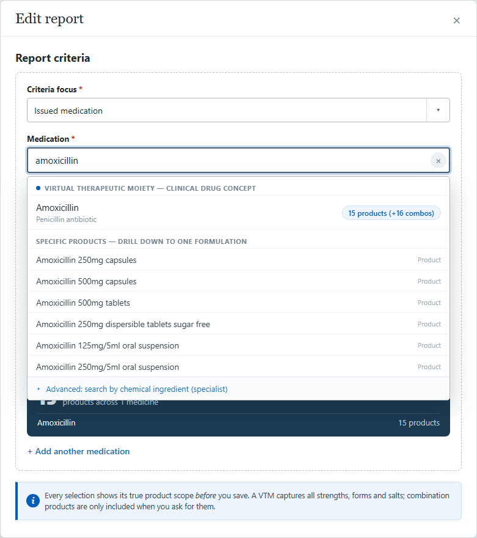

### 2. Advanced ingredient disclosure

Design intent: ingredient mode explains why it is risky, shows ISIDs for specialist users, and makes the zero-product base-substance problem visible.

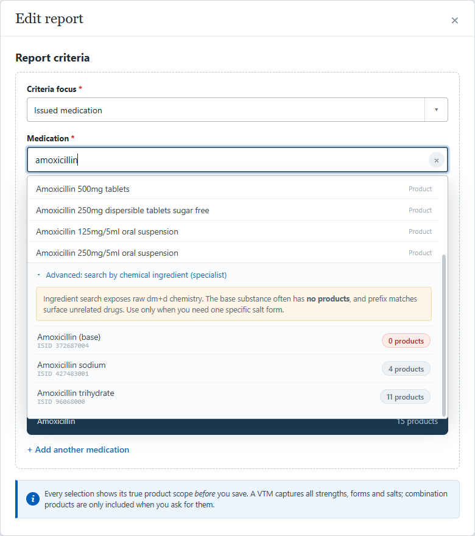

### 3. Selected VTM with combinations OFF

Design intent: the default answer for a selected single VTM is direct-only. The available combination scope is visible but not silently included.

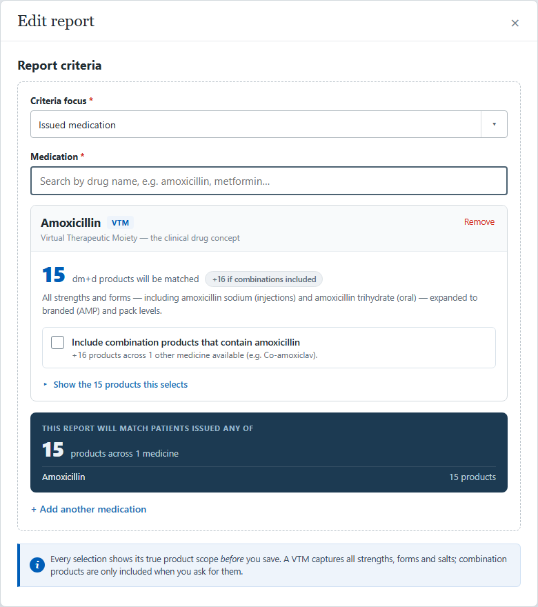

### 4. Selected VTM with combinations ON

Design intent: turning the toggle on changes the count, names the combination VTMs brought into scope, and makes the expanded interpretation explicit.

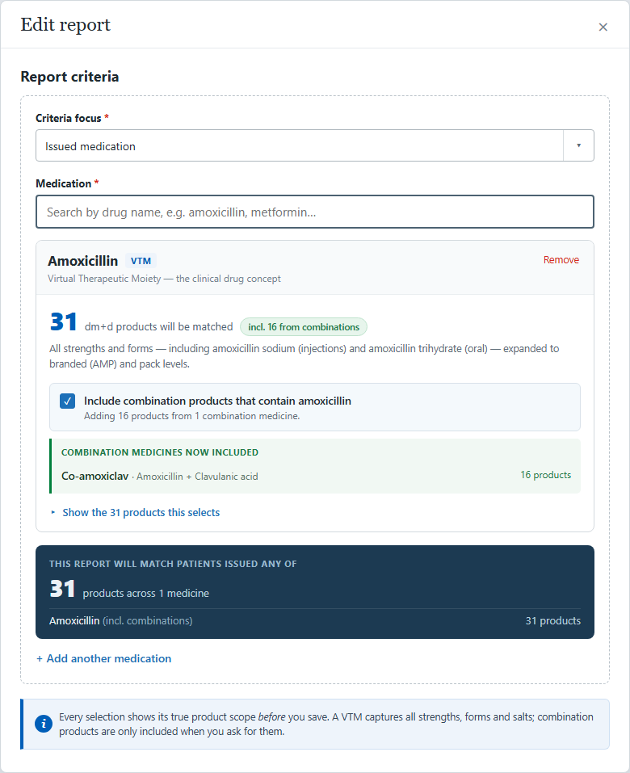

### 5. Named combination guard

Design intent: there is no `include combinations` toggle because the selected VTM is already a combination. The guard is visible enough to explain why no broader expansion occurred.

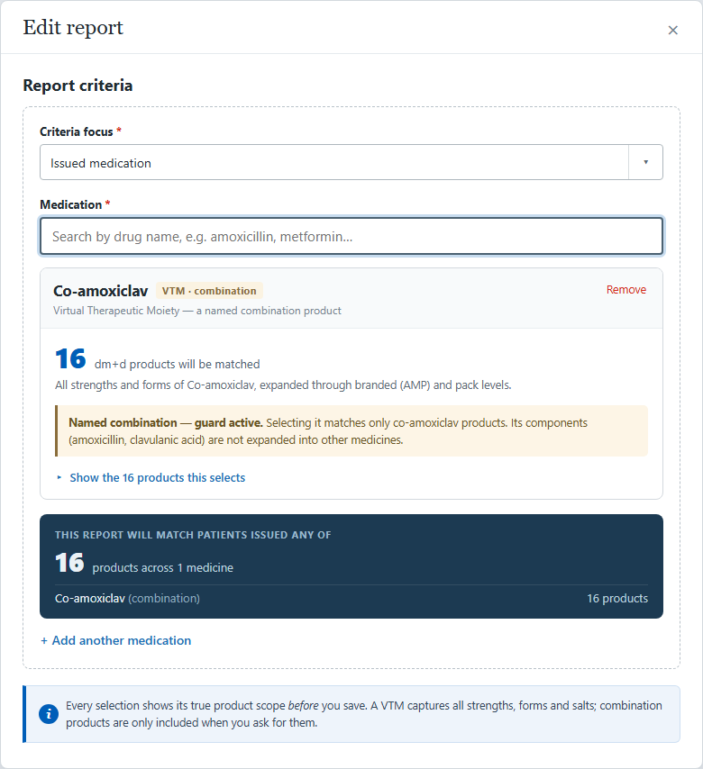

### 6. Named combination guard stress case

Design intent: this wireframe is the evidence case for the named-combination guard. It shows that both naming patterns need protection: standard `" + "` combinations and British Pharmacopoeial `Co-` combinations. Without the guard, the ingredient pivot can turn one deliberately selected combination VTM into hundreds of unrelated products through common ingredients such as salicylic acid or paracetamol. With the guard, the selected combination stays direct-only.

The implementation rule is:

`vtm.nm LIKE '% + %' OR vtm.nm LIKE 'Co-%'`

The guard applies only to the selected input VTM. Guarded combinations can still appear as expansion results when the user starts from a single-drug VTM, such as Amoxicillin expanding to Co-amoxiclav.

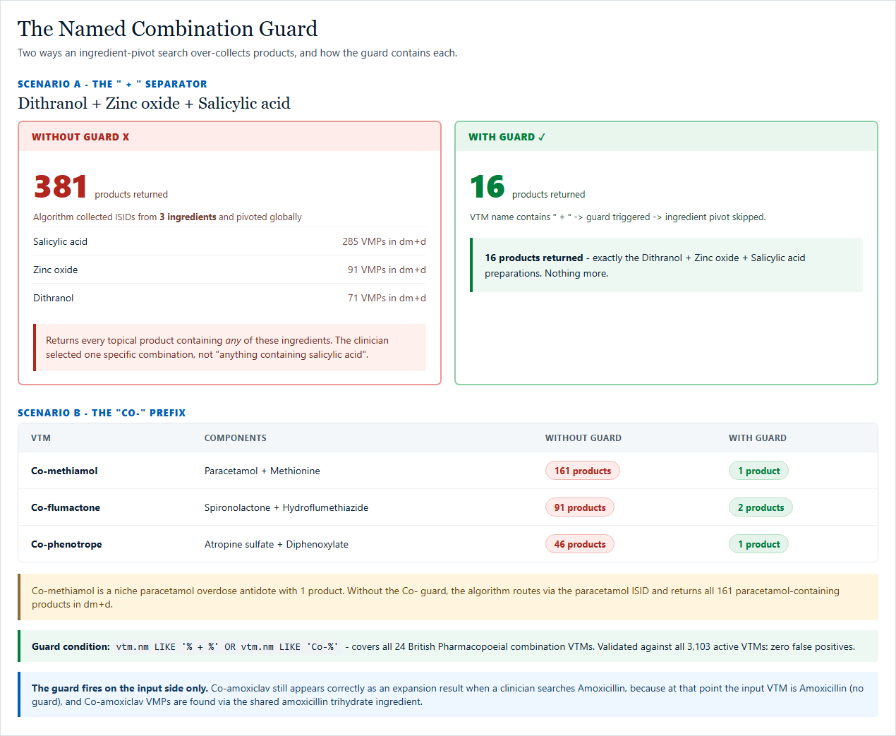

### 7. Clinically separated drug class search

Design intent: dm+d's clinically separated VTMs are respected. The UI shows separate VTM choices instead of merging them into a hidden "all iron" concept. The prototype mock data includes the oral iron examples shown here.

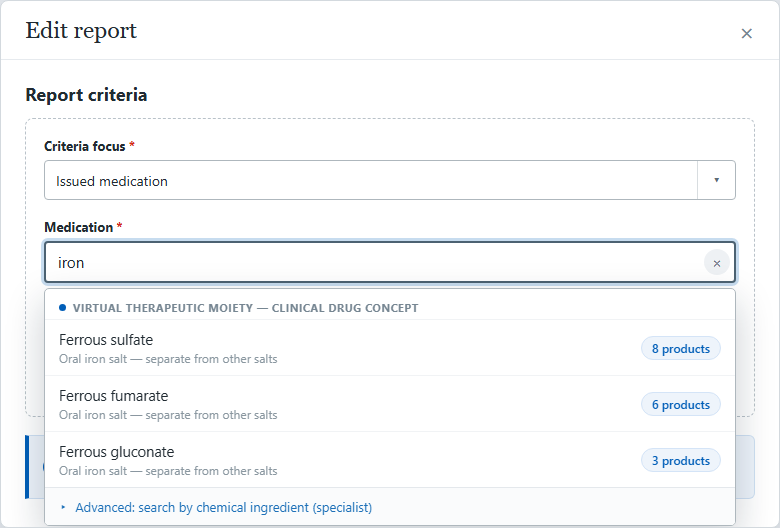

### 8. Clinically separated drug class selection

Design intent: after selecting one separated VTM, the UI helps the user multi-select related concepts but does not merge them invisibly.

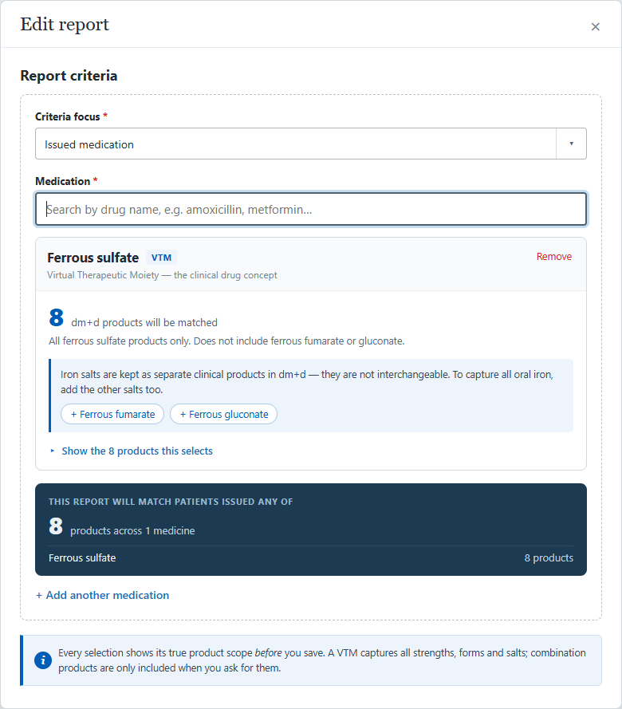

### 9. Prefix collision / ambiguous search

Design intent: short prefixes can surface unrelated medicines. The UI should make the clinical category and product count visible so `Amoxicillin`, `Amoxapine` and `Co-amoxiclav` are not treated as equivalent choices just because they share a string prefix.

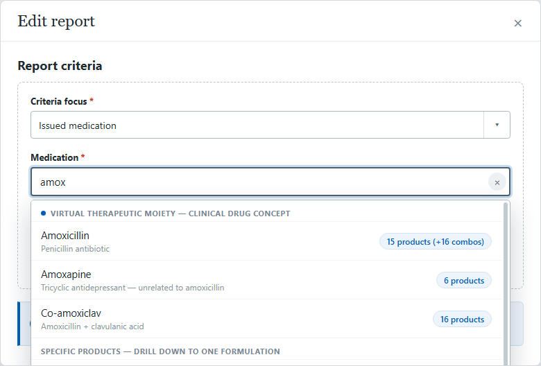

### 10. Specific product drill-down

Design intent: product-level selection is allowed as a deliberate narrow choice. The production UI should distinguish `VMP product family` from `AMP actual product`. A selected VMP should match all child AMPs for that formulation; a selected AMP should show `1` matched actual product and explicitly state that no other brands, strengths, forms or salts are included.

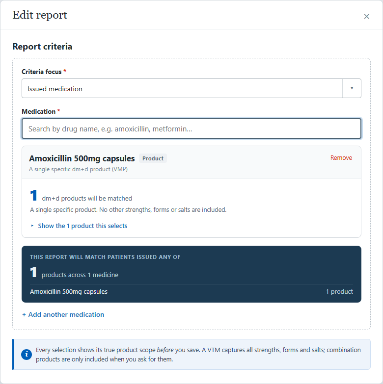

### 11. Expanded product preview

Design intent: the user can inspect the products behind the count before saving. The preview is especially useful for showing that VTM-direct traversal has captured salt/form variants without exposing ingredient search as the main workflow. The production preview should drill from VTM to VMP and then to AMP, because AMPs are what the prescription match will normally use.

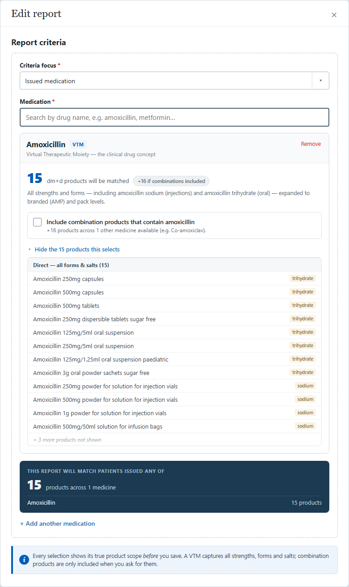

### 12. Multiple medication summary

Design intent: multi-select must keep each medication's scope independent while providing a combined report-level count. Combination inclusion remains per selected VTM, not a global setting.

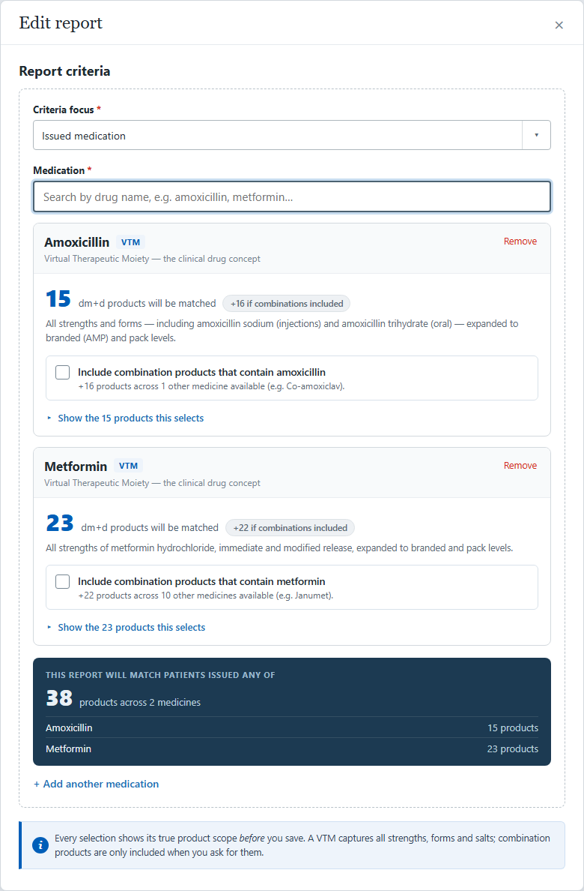

### 13. No-results handling

Design intent: a failed medication search should be quiet and recoverable. It should keep the user in the medication control, show that no match exists, and offer sensible example searches without falling back to raw ingredient matching.

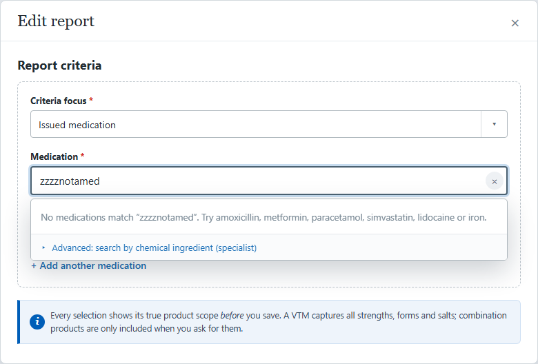

---

## Further Gaps To Cover

The prototype now covers the core happy path and the main interaction edge cases. Before implementation, I would still add design or acceptance criteria for these cases:

1. **Direct-only VTM with no combination products.** Methotrexate or warfarin should show a clean selected VTM card with no combination toggle and no warning. This validates that "no toggle" can mean "nothing extra exists", not a broken resolver.

2. **VTM with no ingredient rows.** Homeopathic products, vaccines/biologics and the 109 current local VTMs with child VMPs but no `vmp_ingredient` rows should still resolve through VTM-direct. The UI should hide combination expansion and optionally show a low-key technical note only to advanced/admin users.

3. **Partial ingredient coverage.** If some direct VMPs have ingredient rows and some do not, the resolver should still include every direct VMP. Combination expansion should use the available ingredient rows, but the implementation should log the partial coverage for QA because it may indicate dm+d source data gaps.

4. **Inactive/historical product policy.** Clinical reporting normally needs historical prescriptions, so the saved definition should specify whether invalid dm+d concepts are included. The UI may not need a user-facing toggle, but the report definition should be explicit and auditable.

5. **Resolver failure/loading states.** Product counts are safety affordances. If counts cannot be calculated, the user should not be allowed to save an apparently valid medication criterion with stale, missing or partial scope.

6. **AMP expansion acceptance criteria.** Every selected VTM or VMP must resolve to the AMP set that will be used against prescription data. The resolver should fail closed if the VMP count is known but the AMP expansion is missing, because that would create a criterion that looks complete in the UI but cannot match the stored prescriptions correctly.

7. **Curated group acceptance criteria.** Ardens/EMIS-like monitoring needs curated medication groups above the resolver. At minimum, high-risk groups such as `All lithium`, `All valproate`, `Systemic ciclosporin`, `ACE inhibitors`, `ARBs`, `DOACs`, `DMARDs`, `Oral iron` and `Parenteral iron` need versioned definitions, source references, VMP/AMP counts, exclusions, and regression tests.

---

## Known Limitations

### Named combination VTMs

The guard (`vtm.nm LIKE '% + %' OR vtm.nm LIKE 'Co-%'`) correctly prevents over-expansion when a clinician explicitly selects a named combination VTM (e.g. "Lidocaine + Adrenaline", "Dithranol + Zinc oxide + Salicylic acid" or "Co-codamol"). For those, VTM-direct is the correct and complete result. The updated guard covers both the standard dm+d separator convention and British pharmacopoeial `Co-` names.

### Clinically separated drug classes

For drugs where dm+d uses intentionally distinct VTMs for each salt or form - iron (Ferrous sulfate, Ferrous fumarate, Ferric carboxymaltose, Iron sucrose each have their own VTM), vitamin D (Colecalciferol and Ergocalciferol are separate VTMs), vitamin B12 (Cyanocobalamin and Hydroxocobalamin are separate) - the algorithm correctly returns only the VTM the user selected. These separations reflect clinical intent in dm+d and should not be merged algorithmically. A user searching for "all iron products" would need to select multiple VTMs, or a drug class grouping concept would be required (which is outside the scope of this algorithm).

### Products without ingredient links

A known subset of VMPs in dm+d have no entries in `vmp_ingredient` - primarily vaccine products, homeopathic products, biologics and occasional composite pack VMPs. In the current local import, 109 active VTMs with active child VMPs have no ingredient coverage at all, and 81 have partial direct-VMP ingredient coverage. These will still be found by VTM-direct search but will not fully participate in the ingredient pivot. For the vast majority of conventional prescription drugs this is not a concern, but the resolver should log it and fail safe by retaining the direct VMP/AMP scope.
